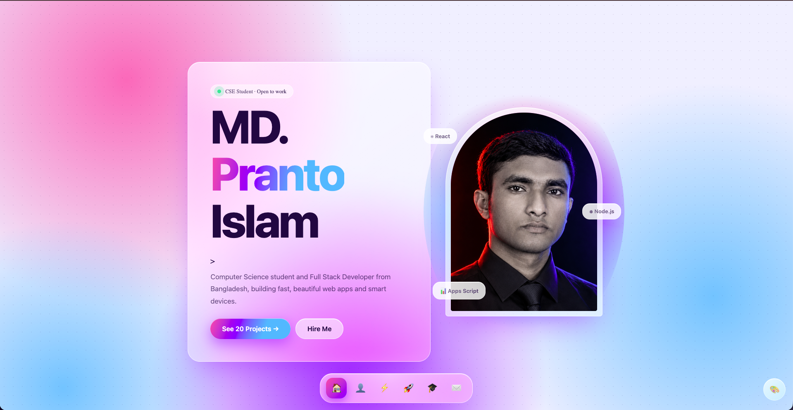
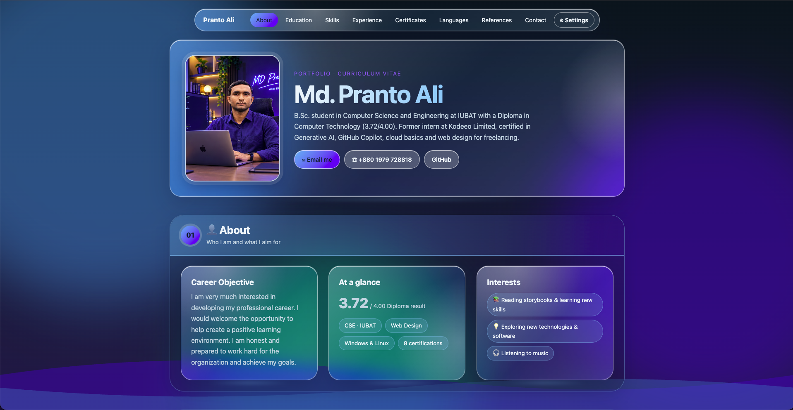

# 🌐 All Portfolio Projects & Web Designs Showcase

  
  
  
  
  
  

Welcome to the **All Portfolio Projects** repository! This repository is a curated collection of **31 unique web portfolio designs, operating system simulations, tactile leather interfaces, and interactive web utilities** created by **Md. Pranto Ali (MD. Pranto Islam)**. 

Each project showcases distinct design philosophies — ranging from **Windows & macOS desktop operating system replicas**, **tactile Skeuomorphic Leather & Stitched Patches UI**, **Neumorphic (Soft-UI) interfaces**, **Cyberpunk Neon aesthetic**, **Modern Bento Grid layouts**, to **Corporate Executive CV designs** and **Web Utility Applications**.

---

## 📑 Table of Contents

- [Quick Project Catalog & Overview Table](#-quick-project-catalog--overview-table)
- [🖥️ 1. Operating System (OS) Simulation Portfolios](#1-operating-system-os-simulation-portfolios)
  - [Windows OS Portfolio](#-windows-os-portfolio)
  - [Mac OS Portfolio](#-mac-os-portfolio)
  - [Pranto OS Portfolio](#-pranto-os-portfolio)
- [🎨 2. Standalone Modern & Creative Portfolios](#2-standalone-modern--creative-portfolios)
  - [Card Layout (Bento Grid)](#-card-layout-bento-grid)
  - [Clock Type (Digital LED Clock Portfolio)](#-clock-type-digital-led-clock-portfolio)
  - [Neion Light V1 (Cyberpunk Glow)](#-neion-light-v1-cyberpunk-glow)
  - [V4 Portfolio (Mono Terminal & Dynamic Gauges)](#-v4-portfolio-mono-terminal--dynamic-gauges)
  - [V5 Portfolio (Executive Curriculum Vitae)](#-v5-portfolio-executive-curriculum-vitae)
- [🛠️ 3. Web Tools & Interactive Utilities](#3-web-tools--interactive-utilities)
  - [Student ID Card Generator](#-student-id-card-generator)
- [🛋️ 4. "Nice & Beautiful Leather" Series (Tactile Skeuomorphic UI)](#4-nice--beautiful-leather-series-tactile-skeuomorphic-ui)
  - [Nice and Beautifull Lather (Master Leather UI)](#-nice-and-beautifull-lather-master-leather-ui)
  - [Nice and Beautifull Lather 1 (Bilingual English/Bangla Edition)](#-nice-and-beautifull-lather-1-bilingual-englishbangla-edition)
  - [Nice and Beautifull Lather 2 (Minimalist Cardfolio)](#-nice-and-beautifull-lather-2-minimalist-cardfolio)
  - [Nice and Beautifull Lather 3 (Numbered Architectural Nav)](#-nice-and-beautifull-lather-3-numbered-architectural-nav)
  - [Nice and Beautifull Lather 4 (Editorial Serif & Stats Dashboard)](#-nice-and-beautifull-lather-4-editorial-serif--stats-dashboard)
- [🚀 5. "Same Type 1" Design Series (V1 – V11)](#5-same-type-1-design-series-v1--v11)
  - [Same Type 1 – V1](#-same-type-1--v1-classic-clean-grid)
  - [Same Type 1 – V2](#-same-type-1--v2-sidebar-dashboard)
  - [Same Type 1 – V3](#-same-type-1--v3-interactive-sidebar--stats)
  - [Same Type 1 – V4](#-same-type-1--v4-open-to-work-sidebar)
  - [Same Type 1 – V5](#-same-type-1--v5-modern-top-nav--hero)
  - [Same Type 1 – V6](#-same-type-1--v6-architectural-numbered-nav)
  - [Same Type 1 – V7](#-same-type-1--v7-sora-typography--ambient-orbs)
  - [Same Type 1 – V8](#-same-type-1--v8-advanced-soft-ui-neumorphism)
  - [Same Type 1 – V9](#-same-type-1--v9-corporate-tech--career-resume)
  - [Same Type 1 – V10](#-same-type-1--v10-flagship-multi-module-portfolio)
  - [Same Type 1 – V11](#-same-type-1--v11-performance-optimized-open-to-work)
- [🌟 6. "Same Type 2" Design Series (V1 – V4)](#6-same-type-2-design-series-v1--v4)
  - [Same Type 2 – V1](#-same-type-2--v1-creative-sparkle--badge)
  - [Same Type 2 – V2](#-same-type-2--v2-streamlined-developer-layout)
  - [Same Type 2 – V3](#-same-type-2--v3-service-oriented-freelance-portfolio)
  - [Same Type 2 – V4](#-same-type-2--v4-agency-style-portfolio)
- [📐 7. "Same Type 3" Design Series (New Layouts)](#7-same-type-3-design-series-new-layouts)
  - [Same Type 3 – New Layout Design 1](#-same-type-3--new-layout-design-1-modern-mono-bento)
  - [Same Type 3 – New Layout Design 2](#-same-type-3--new-layout-design-2-editorial-brutalist)
- [💻 Technology Stack & Architecture](#-technology-stack--architecture)
- [👨‍💻 Developer & Author Information](#-developer--author-information)

---

## 📊 Quick Project Catalog & Overview Table

| # | Project Name | Category / Style | Directory Path | Entry File | Demo Preview |
|---|--------------|------------------|----------------|------------|--------------|
| 1 | **Windows OS** | Windows 10/11 Desktop Simulation | `./Windows OS/` | `index.html` | [View Demo](#-windows-os-portfolio) |
| 2 | **Mac OS** | Apple macOS Ventura/Sonoma UI | `./Mac OS/` | `index.html` | [View Demo](#-mac-os-portfolio) |
| 3 | **Pranto OS** | Custom Web Desktop OS | `./Pranto OS/` | `index.html` | [View Demo](#-pranto-os-portfolio) |
| 4 | **Card Layout** | Bento Grid / Modular Cards | `./Card Layout/` | `index.html` | [View Demo](#-card-layout-bento-grid) |
| 5 | **Clock Type** | Digital LED Dashboard with Clock | `./Clock Type/` | `index.html` | [View Demo](#-clock-type-digital-led-clock-portfolio) |
| 6 | **Neion Light V1** | Dark Cyberpunk Neon & Glassmorphism | `./Neion Light V1/` | `index.html` | [View Demo](#-neion-light-v1-cyberpunk-glow) |
| 7 | **V4** | Terminal Mono & Circular Gauges | `./V4/` | `index.html` | [View Demo](#-v4-portfolio-mono-terminal--dynamic-gauges) |
| 8 | **V5** | Formal Executive CV / Resume | `./V5/` | `MD. Pranto Ali...html` | [View Demo](#-v5-portfolio-executive-curriculum-vitae) |
| 9 | **ID Card Generator** | Interactive Web Tool / Card Printer | `./ID Card Generator/` | `index.html` | [View Demo](#-student-id-card-generator) |
| 10 | **Nice and Beautifull Lather** | Luxury Leather & Stitched Patches UI | `./Nice and Beautifull Lather/` | `index.html` | [View Demo](#-nice-and-beautifull-lather-master-leather-ui) |
| 11 | **Nice and Beautifull Lather 1** | Bilingual (English/বাংলা) Leather UI | `./Nice and Beautifull Lather 1/` | `index.html` | [View Demo](#-nice-and-beautifull-lather-1-bilingual-englishbangla-edition) |
| 12 | **Nice and Beautifull Lather 2** | Minimalist Leather Cardfolio | `./Nice and Beautifull Lather 2/` | `index.html` | [View Demo](#-nice-and-beautifull-lather-2-minimalist-cardfolio) |
| 13 | **Nice and Beautifull Lather 3** | Numbered Architectural Leather Nav | `./Nice and Beautifull Lather 3/` | `index.html` | [View Demo](#-nice-and-beautifull-lather-3-numbered-architectural-nav) |
| 14 | **Nice and Beautifull Lather 4** | Editorial Serif & Stats Leather UI | `./Nice and Beautifull Lather 4/` | `index.html` | [View Demo](#-nice-and-beautifull-lather-4-editorial-serif--stats-dashboard) |
| 15 | **Same Type 1 (V1)** | Classic Clean Minimalist Grid | `./Same Type 1/V1/` | `index.html` | [View Demo](#-same-type-1--v1-classic-clean-grid) |
| 16 | **Same Type 1 (V2)** | Sidebar Navigation & Live Time | `./Same Type 1/V2/` | `index.html` | [View Demo](#-same-type-1--v2-sidebar-dashboard) |
| 17 | **Same Type 1 (V3)** | Sidebar & Performance Metrics | `./Same Type 1/V3/` | `index.html` | [View Demo](#-same-type-1--v3-interactive-sidebar--stats) |
| 18 | **Same Type 1 (V4)** | Open-to-Work Sidebar UI | `./Same Type 1/V4/` | `index.html` | [View Demo](#-same-type-1--v4-open-to-work-sidebar) |
| 19 | **Same Type 1 (V5)** | Modern Top-Nav & Hero Showcase | `./Same Type 1/V5/` | `index.html` | [View Demo](#-same-type-1--v5-modern-top-nav--hero) |
| 20 | **Same Type 1 (V6)** | Numbered Architectural Navigation | `./Same Type 1/V6/` | `index.html` | [View Demo](#-same-type-1--v6-architectural-numbered-nav) |
| 21 | **Same Type 1 (V7)** | Sora Typography & Floating Elements | `./Same Type 1/V7/` | `index.html` | [View Demo](#-same-type-1--v7-sora-typography--ambient-orbs) |
| 22 | **Same Type 1 (V8)** | Soft-UI Neumorphism (10 Themes) | `./Same Type 1/V8/` | `index.html` | [View Demo](#-same-type-1--v8-advanced-soft-ui-neumorphism) |
| 23 | **Same Type 1 (V9)** | Corporate Tech & Minimal Resume | `./Same Type 1/V9/` | `index.html` | [View Demo](#-same-type-1--v9-corporate-tech--career-resume) |
| 24 | **Same Type 1 (V10)** | Flagship Multi-Module Single Page | `./Same Type 1/V10/` | `index.html` | [View Demo](#-same-type-1--v10-flagship-multi-module-portfolio) |
| 25 | **Same Type 1 (V11)** | Optimized "Open to Work" Edition | `./Same Type 1/V11/` | `index.html` | [View Demo](#-same-type-1--v11-performance-optimized-open-to-work) |
| 26 | **Same Type 2 (V1)** | Star Sparkle Hero & Tabbed Milestones | `./Same Type 2/V1/` | `index.html` | [View Demo](#-same-type-2--v1-creative-sparkle--badge) |
| 27 | **Same Type 2 (V2)** | Streamlined Creative Developer UI | `./Same Type 2/V2/` | `index.html` | [View Demo](#-same-type-2--v2-streamlined-developer-layout) |
| 28 | **Same Type 2 (V3)** | Service-Oriented Freelancer Layout | `./Same Type 2/V3/` | `Pranto Ali...html` | [View Demo](#-same-type-2--v3-service-oriented-freelance-portfolio) |
| 29 | **Same Type 2 (V4)** | Creative Agency & Project Showcase | `./Same Type 2/V4/` | `Pranto Ali...html` | [View Demo](#-same-type-2--v4-agency-style-portfolio) |
| 30 | **Same Type 3 (Design 1)** | Earth-Tone Tech Mono Bento | `./Same Type 3/New Layout Design 1/` | `index.html` | [View Demo](#-same-type-3--new-layout-design-1-modern-mono-bento) |
| 31 | **Same Type 3 (Design 2)** | Bold Editorial Brutalist with Syne | `./Same Type 3/New Layout Design 2/` | `index.html` | [View Demo](#-same-type-3--new-layout-design-2-editorial-brutalist) |

---

## 1. Operating System (OS) Simulation Portfolios

### 🪟 Windows OS Portfolio
- **Folder Path:** `Windows OS/`
- **Entry File:** [`Windows OS/index.html`](./Windows%20OS/index.html)
- **Design & Features:**
  - Authentically simulates a Windows 10/11 desktop operating system featuring an interactive Start Menu, taskbar with dynamic system tray (Wi-Fi, sound, battery, and clock), and desktop shortcuts.
  - Includes draggable, resizable application windows that house complete portfolio sections, interactive settings, and lock screen toggle with desktop sound feedback.

  

---

### 🍏 Mac OS Portfolio
- **Folder Path:** `Mac OS/`
- **Entry File:** [`Mac OS/index.html`](./Mac%20OS/index.html)
- **Design & Features:**
  - Flawlessly recreates the Apple macOS desktop environment with frosted-glass glassmorphism, functional top Apple menu bar, dynamic day/night wallpaper toggle, and magnifying dock icons.
  - Equipped with draggable native macOS Finder windows displaying About, Skills, Projects, and Contact tabs, complete with realistic macOS window control buttons and status widgets.

  

---

### 🖥️ Pranto OS Portfolio
- **Folder Path:** `Pranto OS/`
- **Entry File:** [`Pranto OS/index.html`](./Pranto%20OS/index.html)
- **Design & Features:**
  - A modern futuristic custom web operating system featuring an animated boot sequence, desktop shortcut grid, responsive taskbar, and personalized theme accents.
  - Houses interactive floating application windows including a live developer Terminal, interactive Project Explorer, downloadable Resume viewer, and direct contact dialogue.

  

---

## 2. Standalone Modern & Creative Portfolios

### 🗂️ Card Layout (Bento Grid)
- **Folder Path:** `Card Layout/`
- **Entry File:** [`Card Layout/index.html`](./Card%20Layout/index.html)
- **Design & Features:**
  - Contemporary Bento Grid layout built with modern `Bricolage Grotesque` and `Instrument Sans` typography, featuring warm minimalist aesthetics and clean borders.
  - Organizes developer bio, technical skills, education timeline, and contact information into elegant modular tiles with smooth dark/light mode switching.

  

---

### ⏰ Clock Type (Digital LED Clock Portfolio)
- **Folder Path:** `Clock Type/`
- **Entry File:** [`Clock Type/index.html`](./Clock%20Type/index.html)
- **Design & Features:**
  - High-tech digital clock portfolio highlighted by a real-time digital LED display (`Orbitron` font) indicating live time, active day of the week, and dynamic greeting.
  - Combines futuristic dashboard aesthetics with circular skill meters, interactive project highlights, and smooth day/night mode transitions.

  

---

### ⚡ Neion Light V1 (Cyberpunk Glow)
- **Folder Path:** `Neion Light V1/`
- **Entry File:** [`Neion Light V1/index.html`](./Neion%20Light%20V1/index.html)
- **Design & Features:**
  - Cyberpunk-inspired dark neon aesthetic with glowing border effects, glassmorphic backdrop filters, and vibrant neon accent highlights.
  - Features interactive tabbed navigation, animated skill progress meters, certification showcase, and direct contact action triggers.

  

---

### 💻 V4 Portfolio (Mono Terminal & Dynamic Gauges)
- **Folder Path:** `V4/`
- **Entry File:** [`V4/index.html`](./V4/index.html)
- **Design & Features:**
  - Developer-centric mono interface with `DM Mono` and `Bricolage Grotesque` typography, clean pill-based navigation, and code-aesthetic presentation.
  - Showcases dynamic circular skill progress gauges powered by modern CSS `@property`, interactive project cards, and streamlined journey timeline.

  

---

### 📄 V5 Portfolio (Executive Curriculum Vitae)
- **Folder Path:** `V5/`
- **Entry File:** [`V5/MD. Pranto Ali — CSE Student & Web Developer.html`](./V5/MD.%20Pranto%20Ali%20—%20CSE%20Student%20&%20Web%20Developer.html)
- **Design & Features:**
  - Executive Curriculum Vitae (CV) & formal portfolio format tailored for recruiters, with clear academic history, internship credentials, and references.
  - Built with clean corporate styling, printable CV layout, credential verification links, and a collapsible sidebar navigation panel.

  

---

## 3. Web Tools & Interactive Utilities

### 🪪 Student ID Card Generator
- **Folder Path:** `ID Card Generator/`
- **Entry File:** [`ID Card Generator/index.html`](./ID%20Card%20Generator/index.html)
- **Design & Features:**
  - Feature-rich web application for generating professional student/employee ID cards with real-time front & back live preview.
  - Supports dynamic photo uploading, barcode/QR generation, custom department/color theming, multi-card layout printing (1/2/4/8 per page), and high-res PNG/PDF export.

  

---

## 4. "Nice & Beautiful Leather" Series (Tactile Skeuomorphic UI)

The **Nice and Beautiful Leather** series introduces a tactile, skeuomorphic aesthetic where the interface resembles a continuous sheet of handcrafted leather. Typography is pressed into the surface, cards are textured stitched patches, and buttons are plates and straps with dynamic grain and lighting controls.

---

### 🛋️ Nice and Beautifull Lather (Master Leather UI)
- **Folder Path:** `Nice and Beautifull Lather/`
- **Entry File:** [`Nice and Beautifull Lather/index.html`](./Nice%20and%20Beautifull%20Lather/index.html) *(also available as [`iindex.html`](./Nice%20and%20Beautifull%20Lather/iindex.html))*
- **Design & Features:**
  - A handcrafted luxury skeuomorphic portfolio crafted like a continuous sheet of embossed leather with stitched card patches, metal button plates, and `Bodoni Moda` typography.
  - Features interactive surface customization (grain strength slider, leather stitching toggle, matte vs leather textures), dynamic day/night lighting, and rich color palette controls.

  

---

### 🛋️ Nice and Beautifull Lather 1 (Bilingual English/Bangla Edition)
- **Folder Path:** `Nice and Beautifull Lather 1/`
- **Entry File:** [`Nice and Beautifull Lather 1/index.html`](./Nice%20and%20Beautifull%20Lather%201/index.html)
- **Design & Features:**
  - Elegant bilingual portfolio (instant English ↔ বাংলা language toggle) styled with `Playfair Display` and `Hind Siliguri` fonts over a premium leather backdrop.
  - Offers advanced tactile shadow controls (Default / Inner / Outer shadows), matte/glossy leather toggle, and comprehensive academic and experience timelines.

  

---

### 🛋️ Nice and Beautifull Lather 2 (Minimalist Cardfolio)
- **Folder Path:** `Nice and Beautifull Lather 2/`
- **Entry File:** [`Nice and Beautifull Lather 2/index.html`](./Nice%20and%20Beautifull%20Lather%202/index.html)
- **Design & Features:**
  - A streamlined, card-focused leather portfolio emphasizing career objectives, core competencies, and professional education milestones.
  - Built with clean tactile bevels, quick settings drawer, responsive project showcase cards, and instant direct contact channels.

  

---

### 🛋️ Nice and Beautifull Lather 3 (Numbered Architectural Nav)
- **Folder Path:** `Nice and Beautifull Lather 3/`
- **Entry File:** [`Nice and Beautifull Lather 3/index.html`](./Nice%20and%20Beautifull%20Lather%203/index.html)
- **Design & Features:**
  - Architectural portfolio layout featuring numbered index navigation (01 About, 02 Journey, 03 Projects, 04 Certs, 05 Skills, 06 Contact) with a floating settings panel.
  - Combines embossed leather aesthetics with structured engineering credentials, interactive skill chips, and fluid responsive adaptability.

  

---

### 🛋️ Nice and Beautifull Lather 4 (Editorial Serif & Stats Dashboard)
- **Folder Path:** `Nice and Beautifull Lather 4/`
- **Entry File:** [`Nice and Beautifull Lather 4/index.html`](./Nice%20and%20Beautifull%20Lather%204/index.html)
- **Design & Features:**
  - High-end editorial design integrating `Noto Serif Bengali` with bold Roman numerals, prominent metric counters (3.72 CGPA), and interactive modal lightboxes.
  - Delivers a deep tactile leather aesthetic with raised card elevations, expandable project drawers ("See more"), and smooth navigation.

  

---

## 5. "Same Type 1" Design Series (V1 – V11)

The **Same Type 1** series showcases 11 evolutionary iterations of modern personal portfolio designs, experimenting with layouts from classic grids and sidebars to full Soft-UI Neumorphism and high-performance minimal builds.

---

### 🔹 Same Type 1 – V1 (Classic Clean Grid)
- **Folder Path:** `Same Type 1/V1/`
- **Entry File:** [`Same Type 1/V1/index.html`](./Same%20Type%201/V1/index.html)
- **Design & Features:**
  - Clean, content-focused minimalist layout featuring high-contrast typography, top navigation, and classic soft-white card containers.
  - Highlights core engineering background, academic goals, and structured skill sets with quick day/night theme toggling.

  

---

### 🔹 Same Type 1 – V2 (Sidebar Dashboard)
- **Folder Path:** `Same Type 1/V2/`
- **Entry File:** [`Same Type 1/V2/index.html`](./Same%20Type%201/V2/index.html)
- **Design & Features:**
  - Left-docked interactive sidebar navigation with developer avatar, live Dhaka time clock, and quick-action "Hire Me" button.
  - Features a spacious multi-column main view displaying categorized technical skills, project cards, and education milestones.

  

---

### 🔹 Same Type 1 – V3 (Interactive Sidebar & Stats)
- **Folder Path:** `Same Type 1/V3/`
- **Entry File:** [`Same Type 1/V3/index.html`](./Same%20Type%201/V3/index.html)
- **Design & Features:**
  - Sidebar-driven modern interface emphasizing key performance metrics, CGPA badge, and interactive tabbed experience.
  - Designed with smooth scroll spy, animated skill bars, and a clean cards-in-grid system for high readability.

  

---

### 🔹 Same Type 1 – V4 (Open-to-Work Sidebar)
- **Folder Path:** `Same Type 1/V4/`
- **Entry File:** [`Same Type 1/V4/index.html`](./Same%20Type%201/V4/index.html)
- **Design & Features:**
  - Refined sidebar layout highlighting an active "Open to Work" status indicator, social connectivity chips, and clean monochrome styling.
  - Features dedicated journey cards, downloadable CV shortcuts, and a responsive layout that adapts effortlessly to all viewports.

  

---

### 🔹 Same Type 1 – V5 (Modern Top-Nav & Hero)
- **Folder Path:** `Same Type 1/V5/`
- **Entry File:** [`Same Type 1/V5/index.html`](./Same%20Type%201/V5/index.html)
- **Design & Features:**
  - Horizontal top-navigation header with frosted glass effect, prominent hero introduction, and quick-access anchor links.
  - Displays detailed certification badges, experience timeline, and a clean contact form integrated with direct email triggers.

  

---

### 🔹 Same Type 1 – V6 (Architectural Numbered Nav)
- **Folder Path:** `Same Type 1/V6/`
- **Entry File:** [`Same Type 1/V6/index.html`](./Same%20Type%201/V6/index.html)
- **Design & Features:**
  - Architectural layout utilizing numbered menu indices (01 About, 02 Skills, 03 Projects, 04 Journey) and real-time digital clock display.
  - Balances technical precision with modern typography, neat metric counters, and dark/light color mode adaptation.

  

---

### 🔹 Same Type 1 – V7 (Sora Typography & Ambient Orbs)
- **Folder Path:** `Same Type 1/V7/`
- **Entry File:** [`Same Type 1/V7/index.html`](./Same%20Type%201/V7/index.html)
- **Design & Features:**
  - Modern neumorphic-inspired aesthetic powered by Google font `Sora`, with soft raised surfaces and subtle ambient lighting orbs.
  - Features dynamic Day/Night theme toggles, interactive 3D card tilts, and smooth category-based project filters.

  

---

### 🔹 Same Type 1 – V8 (Advanced Soft-UI Neumorphism)
- **Folder Path:** `Same Type 1/V8/`
- **Entry File:** [`Same Type 1/V8/index.html`](./Same%20Type%201/V8/index.html)
- **Design & Features:**
  - Sophisticated Soft-UI (Neumorphism) portfolio with dual-level shadows, 10 vibrant color theme presets, and radial bottom mobile menu.
  - Includes interactive circular skill dials (`@property`), image lightbox modals, full build specifications, and smooth micro-interactions.

  

---

### 🔹 Same Type 1 – V9 (Corporate Tech & Career Resume)
- **Folder Path:** `Same Type 1/V9/`
- **Entry File:** [`Same Type 1/V9/index.html`](./Same%20Type%201/V9/index.html)
- **Design & Features:**
  - Minimalist corporate portfolio focusing on career objectives, academic credentials, and core competencies with live clock status.
  - Clean whitespace distribution and uncluttered card geometry designed for formal client presentations and technical reviews.

  

---

### 🔹 Same Type 1 – V10 (Flagship Multi-Module Portfolio)
- **Folder Path:** `Same Type 1/V10/`
- **Entry File:** [`Same Type 1/V10/index.html`](./Same%20Type%201/V10/index.html)
- **Design & Features:**
  - Full-featured flagship single-page portfolio with extensive navigation, awards & goals modules, and floating quick-action docks.
  - Packed with smooth scroll animations, multi-theme selector, responsive interactive cards, and comprehensive contact hub.

  

---

### 🔹 Same Type 1 – V11 (Performance-Optimized "Open to Work")
- **Folder Path:** `Same Type 1/V11/`
- **Entry File:** [`Same Type 1/V11/index.html`](./Same%20Type%201/V11/index.html)
- **Design & Features:**
  - High-performance, clean developer portfolio featuring an animated "Open to work" badge, dynamic typewriter header, and lightweight architecture.
  - Includes dark/light mode switching, modular journey and skills timeline, and streamlined zero-friction assets for ultra-fast page loading.

  

---

## 6. "Same Type 2" Design Series (V1 – V4)

The **Same Type 2** collection highlights bold, creative agency-style designs, with attention-grabbing badge headers, star sparkles, and service showcases.

---

### 🌟 Same Type 2 – V1 (Creative Sparkle & Badge)
- **Folder Path:** `Same Type 2/V1/`
- **Entry File:** [`Same Type 2/V1/index.html`](./Same%20Type%202/V1/index.html)
- **Design & Features:**
  - Vibrant creative personal portfolio with decorative star accents, animated hero typography, and floating "Let's Talk" CTA.
  - Features tabbed education milestones, achievement highlights, and responsive interactive project cards with light/dark toggles.

  

---

### 🌟 Same Type 2 – V2 (Streamlined Developer Layout)
- **Folder Path:** `Same Type 2/V2/`
- **Entry File:** [`Same Type 2/V2/index.html`](./Same%20Type%202/V2/index.html)
- **Design & Features:**
  - Enhanced modern header with subtitle branding, balanced typography, and streamlined achievement metrics.
  - Highlights technical proficiencies and portfolio case studies with smooth hover animations and direct contact access.

  

---

### 🌟 Same Type 2 – V3 (Service-Oriented Freelance Portfolio)
- **Folder Path:** `Same Type 2/V3/`
- **Entry File:** [`Same Type 2/V3/Pranto Ali — CSE Student & Web Designer.html`](./Same%20Type%202/V3/Pranto%20Ali%20—%20CSE%20Student%20&%20Web%20Designer.html)
- **Design & Features:**
  - Client-focused layout highlighting offered web services (frontend design, responsive UI, bug fixes) alongside academic background.
  - Features visual project gallery showcase, client collaboration workflow, and fast contact inquiry integration.

  

---

### 🌟 Same Type 2 – V4 (Agency-Style Portfolio)
- **Folder Path:** `Same Type 2/V4/`
- **Entry File:** [`Same Type 2/V4/Pranto Ali — Portfolio.html`](./Same%20Type%202/V4/Pranto%20Ali%20—%20Portfolio.html)
- **Design & Features:**
  - Polished freelancer portfolio with dedicated services breakdown, curated project portfolio, and bold call-to-action buttons.
  - Optimized for client conversion with clean responsive cards, testimonial/reference readiness, and direct social messaging links.

  

---

## 7. "Same Type 3" Design Series (New Layouts)

The **Same Type 3** series explores modern editorial, retro-modern, and brutalist layouts with specialized Google typography.

---

### 📐 Same Type 3 – New Layout Design 1 (Modern Mono Bento)
- **Folder Path:** `Same Type 3/New Layout Design 1/`
- **Entry File:** [`Same Type 3/New Layout Design 1/index.html`](./Same%20Type%203/New%20Layout%20Design%201/index.html)
- **Design & Features:**
  - Contemporary developer theme combining `JetBrains Mono` and `Space Grotesk` fonts with an earth-tone retro modern background.
  - Features modular bento-style skill cards, live theme picker (light/dark/custom), and detailed journey timeline.

  

---

### 📐 Same Type 3 – New Layout Design 2 (Editorial Brutalist)
- **Folder Path:** `Same Type 3/New Layout Design 2/`
- **Entry File:** [`Same Type 3/New Layout Design 2/index.html`](./Same%20Type%203/New%20Layout%20Design%202/index.html)
- **Design & Features:**
  - High-impact editorial design combining bold `Syne` headline typography with `Manrope` and `DM Mono` for a striking visual identity.
  - Showcases distinctive card borders, interactive filterable project grids, and polished dark/light mode switching.

  

---

## 💻 Technology Stack & Architecture

- **Core Technologies:** HTML5 Semantic Markup, CSS3 Custom Properties (Variables), Vanilla JavaScript (ES6+).
- **Zero Heavy Dependencies:** High-performance, lightweight, self-contained single-page templates without complex framework builds.
- **Modern Typography:** Google Fonts (`Bodoni Moda`, `Playfair Display`, `Hind Siliguri`, `Noto Serif Bengali`, `Sora`, `JetBrains Mono`, `Syne`, `Bricolage Grotesque`, `Manrope`, `Orbitron`, `Roboto`, `Instrument Sans`).
- **Icons & Visuals:** Font Awesome 6, SVG vector icons, dynamic canvas / CSS animations, tactile leather textures.
- **Theming & Responsiveness:** Fully responsive across mobile, tablet, and widescreen desktop devices with seamless dark/light mode switching and texture controls.

---

## 👨‍💻 Developer & Author Information

<table align="center" width="100%">
  <tr>
    <td width="30%" align="center" valign="middle">
       
      <b>Md. Pranto Ali</b> 
      <i>(MD. Pranto Islam)</i>
    </td>
    <td width="70%" valign="top">
      <h3>Md. Pranto Ali</h3>
      
<b>Computer Science & Engineering Student | Frontend & Web Designer | Aspiring Full-Stack Software Engineer</b>

      <ul>
        <li>🎓 <b>B.Sc. in Computer Science & Engineering (Running):</b> IUBAT – International University of Business Agriculture and Technology (Student ID: 23303101)</li>
        <li>🏅 <b>Diploma in Engineering (Computer Technology):</b> Kamrul Islam Siddiqui Polytechnic Institute (Result: <b>3.72</b> / 4.00, Year 2023)</li>
        <li>💼 <b>Professional Internship:</b> Former Intern at <i>Kodeeo Limited</i> (6 months)</li>
        <li>📍 <b>Current Address:</b> House No: 18, Road No: 10, Sector 10, Uttara, Dhaka-1230, Bangladesh</li>
        <li>🏡 <b>Permanent Address:</b> Village: Hridoypur, P.O: Satarpara, District: Kushtia, Khulna, Bangladesh</li>
      </ul>
    </td>
  </tr>
</table>

### 📬 Get In Touch & Social Links

- **📧 Email:** [prantoislamnt51@gmail.com](mailto:prantoislamnt51@gmail.com)
- **📱 Phone / WhatsApp:** [+880 1979 728818](https://wa.me/8801979728818)
- **💻 GitHub:** [@pranto2051](https://github.com/pranto2051)
- **🌐 Portfolio Repository:** [github.com/pranto2051/All_Portfolio_Project](https://github.com/pranto2051/All_Portfolio_Project)
- **🔗 LinkedIn:** [linkedin.com](https://www.linkedin.com)
- **💬 Facebook:** [facebook.com](https://www.facebook.com)

> *"I am honest, hardworking, and passionate about turning creative ideas into practical, high-performance digital experiences. Dedicated to continuous learning and excellence."*

---

  <b>© Md. Pranto Ali — All Rights Reserved. Built with passion & dedication.</b>

